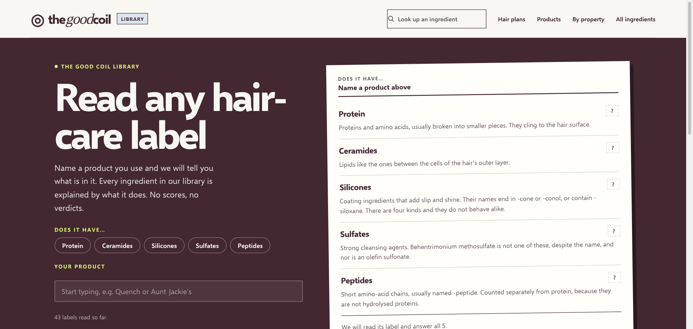
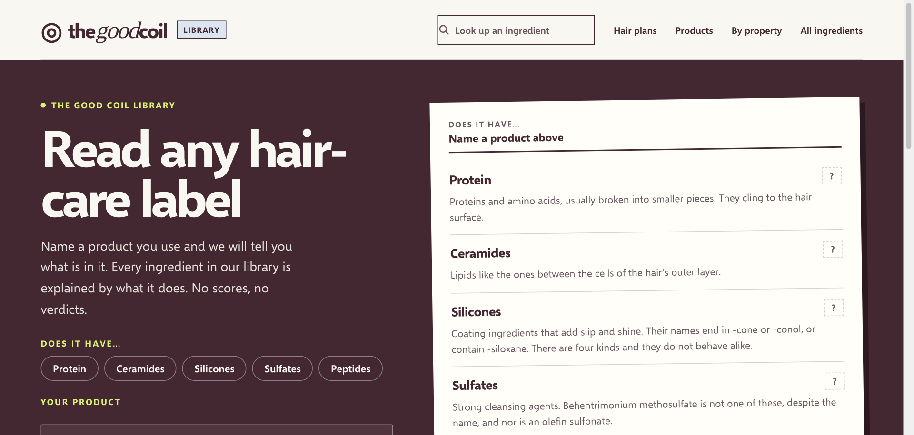
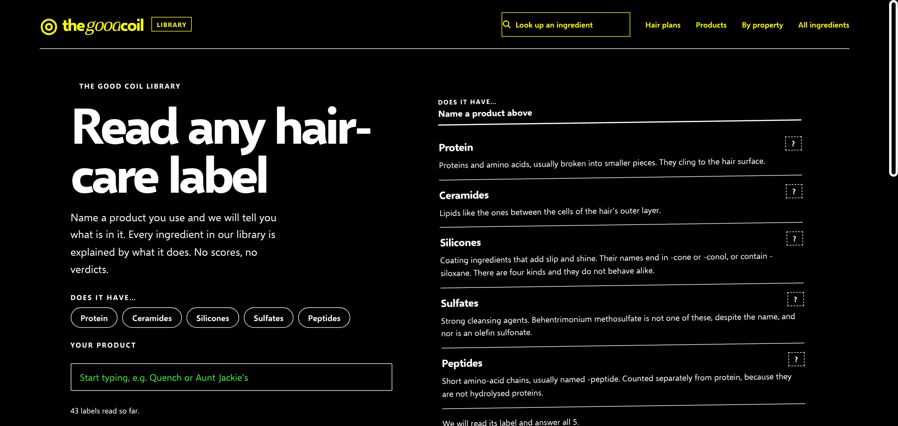
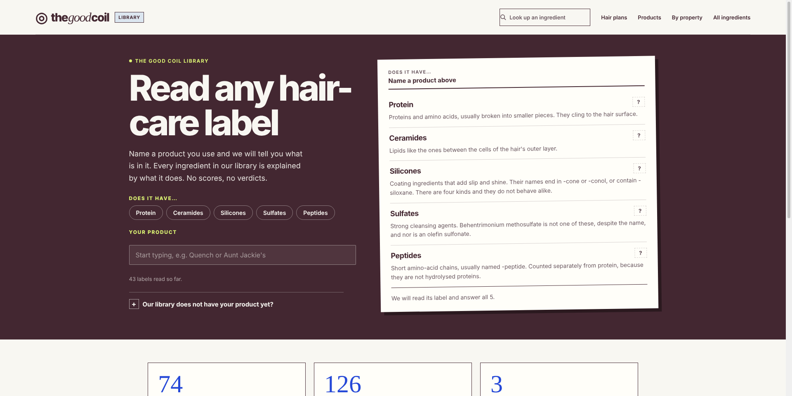
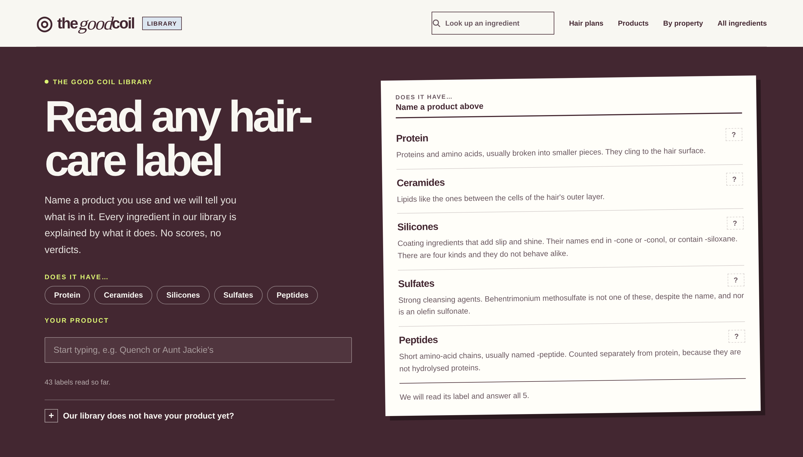
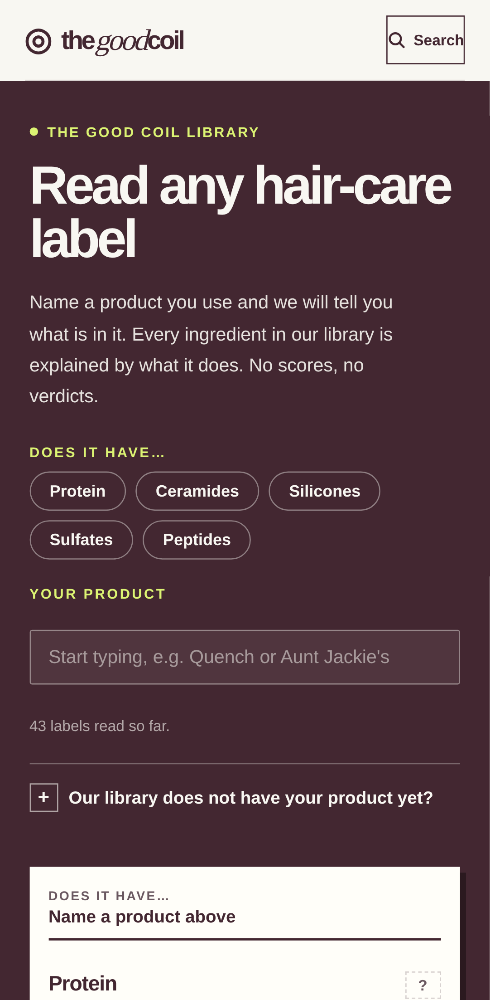
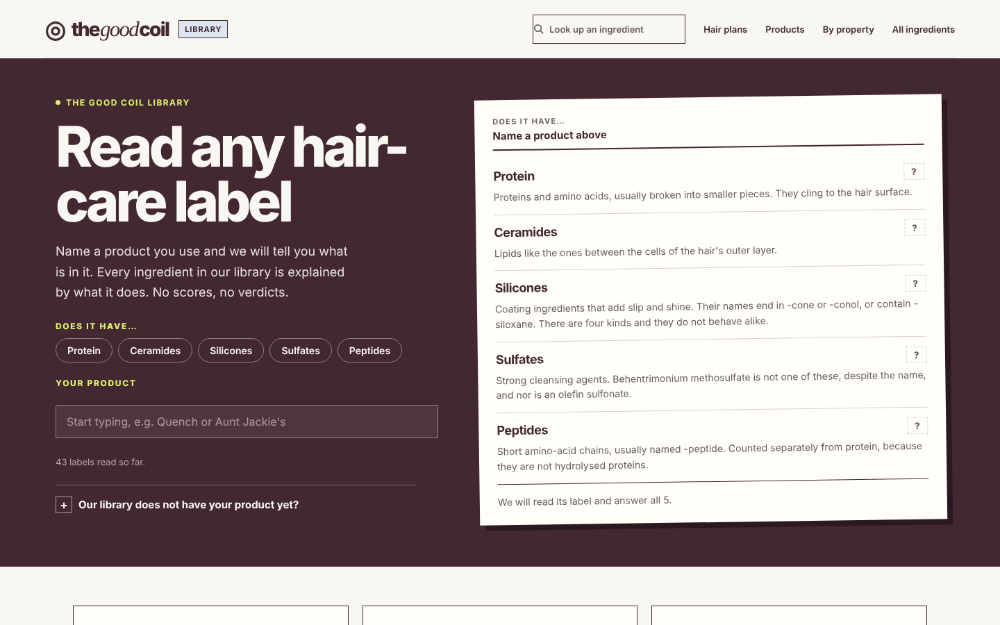
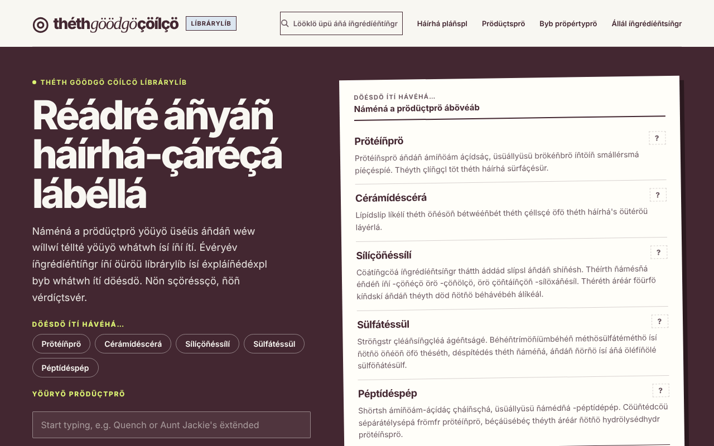
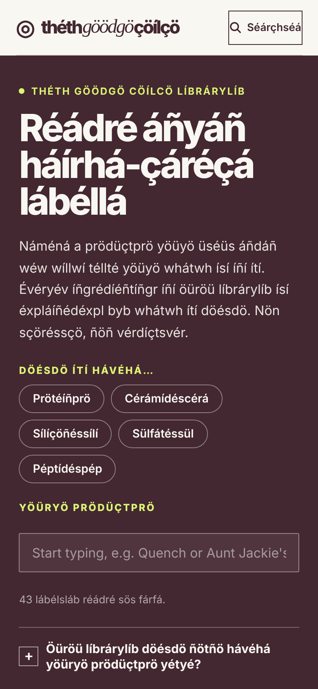

# Matrix: http://localhost:8777/

Host: linux (6.18.44-fc-v470). Fonts on other OSes are metric-compatible stand-ins.

## windows-125 · 1536×730 @1.25x · Google Chrome

- note: Text in system-font stacks renders as: Instrument Serif, Georgia, serif → Georgia (e.g. "good")
- warn: 3 text blocks wrap onto more lines with windows fonts: "the coil" 5→6 lines; "Name a product you use and w" 3→4 lines; "the coil" 3→4 lines

## windows-150 · 1280×610 @1.5x · Google Chrome

- note: Text in system-font stacks renders as: Instrument Serif, Georgia, serif → Georgia (e.g. "good")
- warn: 3 text blocks wrap onto more lines with windows fonts: "the coil" 5→6 lines; "Name a product you use and w" 3→4 lines; "the coil" 3→4 lines

## windows-hc · 1536×730 @1.25x · Google Chrome

- note: Text in system-font stacks renders as: Instrument Serif, Georgia, serif → Georgia (e.g. "good")
- warn: 3 text blocks wrap onto more lines with windows fonts: "the coil" 5→6 lines; "Name a product you use and w" 3→4 lines; "the coil" 3→4 lines

## linux · 1920×960 @1x · Google Chrome

## mac · 1440×820 @2x · Google Chrome

- note: Text in system-font stacks renders as: Instrument Serif, Georgia, serif → Georgia (e.g. "good")

## android · 412×840 @2.625x · Google Chrome

- note: Text in system-font stacks renders as: Instrument Serif, Georgia, serif → Noto Serif (e.g. "good")

## firefox

Skipped: firefox is not installed. Optional: node "/root/.claude/skills/synced/acc60c30-9374-48b8-b15f-84174e6ecc5b_67a8110e-32e8-4514-b8ab-8cc829f6e918/web-designer/scripts/doctor.mjs" --engines

## safari

Skipped: webkit is not installed. Optional: node "/root/.claude/skills/synced/acc60c30-9374-48b8-b15f-84174e6ecc5b_67a8110e-32e8-4514-b8ab-8cc829f6e918/web-designer/scripts/doctor.mjs" --engines

## safari-iphone

Skipped: webkit is not installed. Optional: node "/root/.claude/skills/synced/acc60c30-9374-48b8-b15f-84174e6ecc5b_67a8110e-32e8-4514-b8ab-8cc829f6e918/web-designer/scripts/doctor.mjs" --engines

## reflow-320 · 320×640 @2x · Google Chrome

## motion · 1440×900 @1x · Google Chrome

## l10n · 1280×800 @1x · Google Chrome

## l10n-phone · 390×844 @2x · Google Chrome

